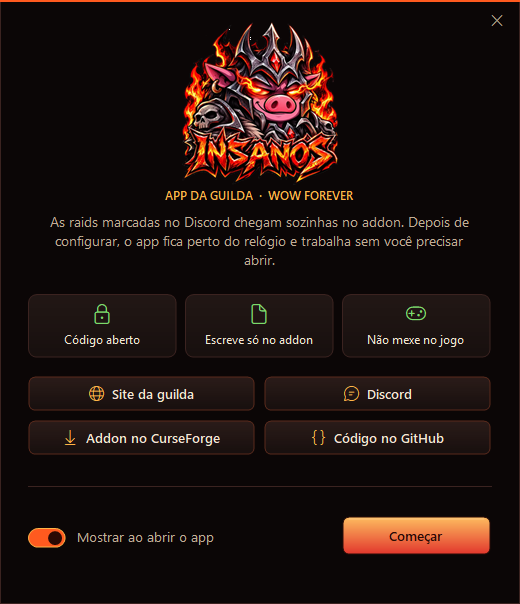
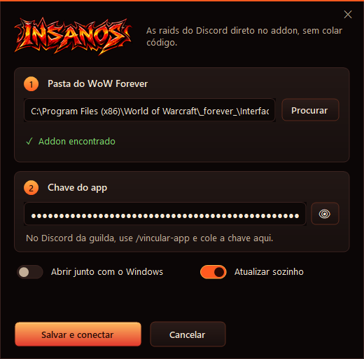
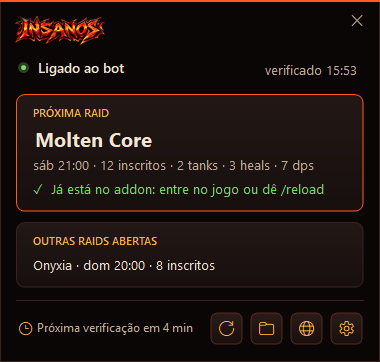
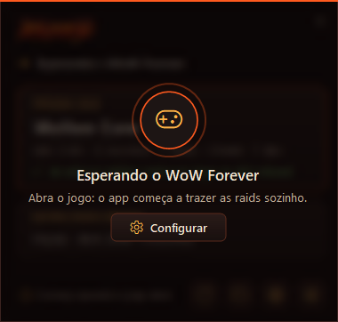
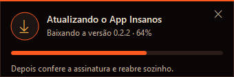
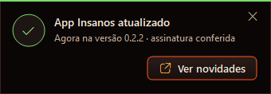

  
  &nbsp;&nbsp;
  

  
  
  

# App Insanos (PC)

App da guilda **INSANOS** (WoW Forever) para Windows. Ele leva as raids marcadas no Discord direto para o addon
[Insanos Guild Sync](https://www.curseforge.com/wow/addons/insanos-guild-sync), sem precisar copiar e colar a chave
`!NILBAS`. É para oficiais e líderes de raid. Usar é opcional: colar a chave no addon continua funcionando igual.

> **Baixar:** o `.exe` da versão mais nova está em [Releases](../../releases/latest). Não precisa instalar nada.

## Telas

<table>
<tr>
<td align="center" width="50%"> Boas-vindas ao abrir, com os links da guilda</td>
<td align="center" width="50%"> Configuração: a pasta do jogo e a chave do <code>/vincular-app</code></td>
</tr>
<tr>
<td align="center"> Perto do relógio: a próxima raid, já no addon</td>
<td align="center"> Com o WoW Forever fechado, o app espera o jogo abrir</td>
</tr>
<tr>
<td align="center"> Atualização: baixa e confere a assinatura</td>
<td align="center"> …e avisa quando terminou</td>
</tr>
</table>

## Como funciona

1. No Discord da guilda, use `/vincular-app` e copie a chave (ela aparece só para você).
2. Abra o app, confira a pasta do WoW Forever e cole a chave.
3. O app fica perto do relógio. A cada 30 segundos (15 perto da hora da raid) ele pergunta ao bot quais raids você
   lidera e deixa a lista pronta no addon. Entre no jogo ou clique em "Puxar do app" na aba Raid: a raid já aparece
   carregada, e "Trocar raid" escolhe outra. Ninguém é convidado sozinho.

Para desligar: `/desvincular-app` no Discord, e "Sair" no menu do ícone.

## Segurança

O código deste repositório é todo o app: dá para ler cada linha. O resumo do que ele faz e do que não faz:

**O que o app faz**

- **Conversa com dois lugares só:** `https://insanos.discloud.app`, o bot da guilda
  ([`InboxApi.cs`](InsanosApp/Core/InboxApi.cs)), para mandar a sua chave e receber as chaves `!NILBAS` das raids que
  você lidera; e o GitHub deste repositório, para ver se saiu versão nova ([`Updater.cs`](InsanosApp/Core/Updater.cs)).
- **Só trabalha com o WoW Forever aberto:** com o jogo fechado, o app fica parado e não chama o bot. Para saber se
  o jogo está aberto, ele só pergunta ao Windows o caminho do `Wow.exe` (o mesmo que o Gerenciador de Tarefas mostra),
  sem ler a memória do jogo ([`GameWatch.cs`](InsanosApp/Core/GameWatch.cs)).
- **Se atualiza sozinho, com conferência:** a cada 6 horas o app olha os [Releases](../../releases/latest). Se
  houver versão nova, baixa o `.exe` e só troca o arquivo se a assinatura `.sig` bater com a chave pública que vem
  dentro do app. Essa assinatura só é feita pelo workflow de lançamento deste repositório: um `.exe` posto ali por
  outra pessoa é recusado. Dá para desligar em "Atualizar sozinho", e aí o app só avisa.
- **Escreve um arquivo só no jogo:** `Interface\AddOns\NilbasForever\Inbox.lua`, com essas chaves
  ([`InboxFile.cs`](InsanosApp/Core/InboxFile.cs)). Antes de escrever, joga fora tudo que não for uma chave válida
  (só letras, números e `+/=`, até 10 chaves): nada que vem da internet vira código no jogo. O addon confere tudo de
  novo antes de usar.
- **Guarda as configurações** em `%APPDATA%\InsanosApp\config.json`: a pasta do jogo e a sua chave. A chave fica
  protegida pelo Windows (DPAPI), e só o seu usuário consegue abrir ([`KeyVault.cs`](InsanosApp/KeyVault.cs)).
- **"Abrir junto com o Windows"** só liga se você marcar, e é só para o seu usuário
  ([`Startup.cs`](InsanosApp/Startup.cs)).

**O que o app não faz**

- Não pede, não lê e não guarda senha nenhuma (Battle.net, WoW ou Discord).
- Não lê a memória do jogo, não injeta nada, não aperta teclas e não automatiza nada no WoW.
- Não manda nada do seu PC: nem tela, nem arquivos, nem dados pessoais. Só a chave do `/vincular-app`.
- Não roda como administrador.
- A chave só lê as raids que você lidera. Ela não dá acesso à sua conta do Discord, e `/desvincular-app` desliga na hora.

**Como conferir que o .exe é deste código**

Cada versão é montada pelo próprio GitHub, a partir deste código, no workflow
[`release.yml`](.github/workflows/release.yml), e não no computador de ninguém. Em cada release:

- **Atestação do GitHub:** prova assinada de que o `.exe` saiu deste repositório e deste workflow. Para conferir:
  `gh attestation verify .\InsanosApp-X.Y.Z.exe -R sklta/insanos-app`
- **SHA-256:** a impressão digital do arquivo. No PowerShell: `Get-FileHash .\InsanosApp-X.Y.Z.exe -Algorithm SHA256`
  (tem que dar o mesmo valor publicado no release).
- **VirusTotal:** o link da análise de dezenas de antivírus vai junto no release.

Enquanto o `.exe` não tiver assinatura digital (veja abaixo), na primeira vez o Windows pode mostrar "O Windows
protegeu o computador". Clique em "Mais informações" e "Executar assim mesmo", depois de conferir o arquivo como acima.

Achou um problema de segurança? Avise um oficial da guilda no Discord ou abra uma issue.

Privacidade: o que o app guarda e envia está em [`PRIVACY.md`](PRIVACY.md).

## Code signing policy / Política de assinatura

We applied for free code signing from the [SignPath Foundation](https://signpath.org). Once approved, Windows releases
will be signed: *Free code signing provided by [SignPath.io](https://signpath.io), certificate by
[SignPath Foundation](https://signpath.org).*

- Only files built by GitHub Actions from this repository ([`release.yml`](.github/workflows/release.yml)) are signed.
  Nothing built on a personal computer is ever signed.
- Committers and reviewers: [sklta](https://github.com/sklta).
- Approvers (each signing request is approved by hand): [sklta](https://github.com/sklta).
- Privacy: [`PRIVACY.md`](PRIVACY.md). The app sends no data except the app key to the guild's bot.

Pedimos a assinatura gratuita do SignPath Foundation. Quando aprovada, os `.exe` deste repositório saem assinados,
sempre montados pelo GitHub a partir deste código e aprovados um a um.

## Para quem programa

- `InsanosApp/`: o app (.NET 10, Windows Forms). `Core/` é o núcleo, sem tela.
- `InsanosApp.Tests/`: testes do núcleo, sem pacotes de fora: `dotnet run --project InsanosApp.Tests`
- Gerar o `.exe` como o GitHub faz: veja o passo "Gerar o .exe" em [`release.yml`](.github/workflows/release.yml).

## Links

- Site da guilda: https://insanos.discloud.app
- Addon no CurseForge: https://www.curseforge.com/wow/addons/insanos-guild-sync

Código sob a licença MIT ([`LICENSE`](LICENSE)). Site e app de fã, sem ligação com a Blizzard Entertainment.
